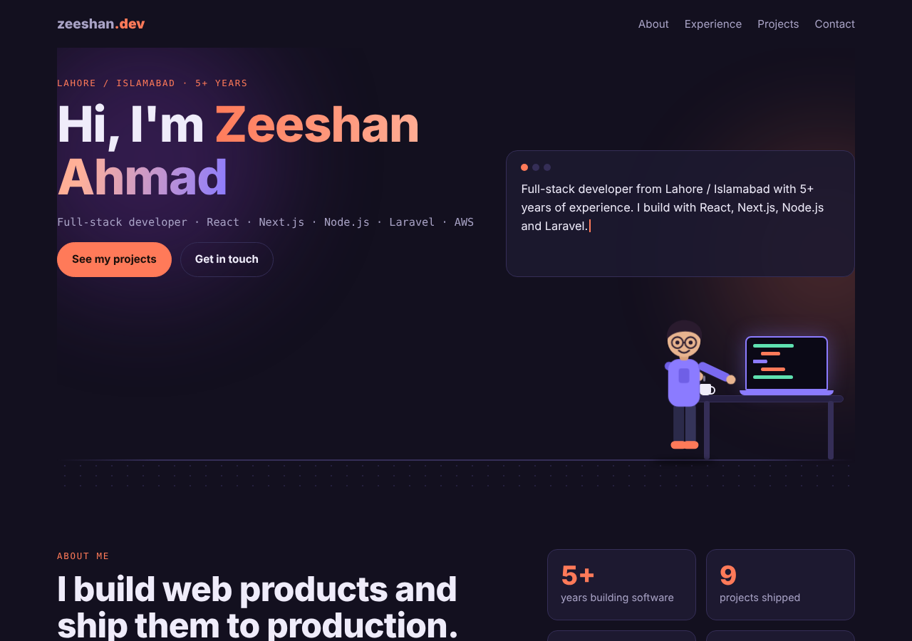

# Zeeshan Ahmad – Portfolio (Next.js)



Next.js 15 (App Router) portfolio with an animated walking/typing avatar hero and a project slider.

## Run locally
```bash
npm install
npm run dev      # http://localhost:3000
```

## Deploy to Vercel
**Option A – GitHub (recommended)**
1. Create a GitHub repo and push this folder.
2. Go to vercel.com → Add New → Project → import the repo.
3. Framework is detected as Next.js. Click Deploy.

**Option B – CLI**
```bash
npm i -g vercel
vercel          # first deploy (preview)
vercel --prod   # production
```

## Edit content
Projects, skills, experience and contact details are in `lib/data.js`.
Styles are in `app/globals.css`.
